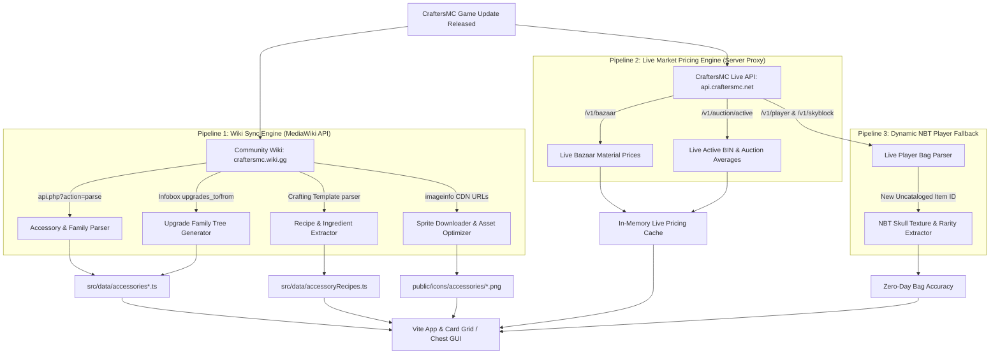

# CraftersMC Accessory Bag Auditor: End-to-End Automation Plan

> **Goal:** Fully automate the discovery of new accessories, upgrade family relationships, crafting recipes, material costs (Bazaar/AH), and pixel-art textures without requiring manual code changes when CraftersMC releases game updates.

---

## 1. High-Level Architecture Overview

---

## 2. The Four Automated Pipelines

### Pipeline 1: Catalog & Upgrade Family Automation (Wiki MediaWiki API)

* **Data Source:** `https://craftersmc.wiki.gg/api.php`
* **Discovery Strategy:**
  1. Query `action=parse&page=Accessories&format=json` to fetch the master accessories wiki table.
  2. Detect new accessory entries by comparing names and internal IDs against the local `ALL_ACCESSORIES` registry.
  3. Query the individual page infobox for each new accessory to extract:
     * `| rarity = ...` → Maps to base rarity and authentic Thaumaturgy Magical Power (MP).
     * `| upgrades_from = ...` & `| upgrades_to = ...` → Automatically establishes the upgrade family tree without human guesswork.
     * `| category = ...` → Collection, Slayer, Event, Quest, or Hub Shop.
     * `| npc_cost = ...` → Vendor coin purchase price (suppresses unnecessary auction house calculations).
* **Output:** Auto-generated `src/data/accessoriesAuto.ts` (or updates to modular category files).

---

### Pipeline 2: Crafting Recipes & Material Requirements Automation

* **Data Source:** MediaWiki Recipe Templates (e.g. `{{Recipe}}` or `{{Crafting_Recipe}}` on accessory wiki pages).
* **Extraction Strategy:**
  1. Parse the 3x3 crafting grid template parameters (`|A1=`, `|B2=`, `|count=`, etc.).
  2. Resolve in-game material names to standardized Bazaar item IDs (e.g., *"Enchanted Feather"* → `enchanted_feather`, *"Revenant Viscera"* → `revenant_viscera`).
  3. Detect base accessory components (e.g. recipe requiring a *Zombie Talisman* to craft a *Zombie Ring*).
* **Output:** Auto-generated `src/data/accessoryRecipesAuto.ts` with validated `AccessoryRecipe` types.

---

### Pipeline 3: Sprite & Texture Automation (Dual-Layer)

* **Layer A (Wiki Asset Pipeline):**
  1. The sync script queries `action=query&titles=File:{ItemName}.png&prop=imageinfo&iiprop=url|sha1`.
  2. Downloads the official pixel sprite directly into `/public/icons/accessories/{id}.png`.
  3. When CraftersMC updates a texture and wiki editors upload a new revision, the script compares the image SHA1 hash and replaces the outdated PNG automatically.
* **Layer B (Dynamic NBT Skull Texture Fallback):**
  * For accessories that are custom Minecraft heads (~85% of SkyBlock accessories):
  * When the app fetches a player's accessory bag via API, the parser extracts `SkullOwner.Properties.textures[0].Value`.
  * Decodes the Base64 JSON to extract the direct Mojang CDN URL: `https://textures.minecraft.net/texture/<hash>`.
  * If a local PNG file does not exist yet, the icon component streams the Mojang texture directly, ensuring zero missing textures even on day one of a game update.

---

### Pipeline 4: Live Bazaar & Auction Pricing Engine

* **Data Sources:**
  * `https://api.craftersmc.net/v1/bazaar`
  * `https://api.craftersmc.net/v1/auction/active`
* **Implementation Strategy:**
  1. **Server Proxy Background Worker (`vite.config.ts` / Node server):**
     * Polls `/v1/bazaar` and `/v1/auction/active` on an asynchronous 10-minute interval.
     * Uses secure server-side API Key (`CRAFTERS_API_KEY`).
     * Complies with CraftersMC rate limits (40 requests/min maximum).
  2. **In-Memory Price Cache:**
     * Computes 7-day average Bazaar material costs and outlier-trimmed BIN auction medians.
     * Serves dynamic `/api/v1/pricing/summary` endpoint to client.
  3. **Offline Resiliency:**
     * If the CraftersMC API is unreachable, the client seamlessly falls back to `src/data/pricingData.ts`.

---

## 3. Automation Execution Workflow

We will support three seamless operational modes:

| Mode | Mechanism | Purpose |
| :--- | :--- | :--- |
| **1. One-Command Local Sync** | `npm run sync:wiki` | Developers or maintainers can sync all accessories, recipes, and sprites with one command in < 15 seconds. |
| **2. GitHub Actions Cron** | `.github/workflows/auto-sync.yml` (Runs daily at midnight UTC) | Automatically checks the wiki and API daily. If new accessories or price shifts are found, it commits and triggers a static build automatically. |
| **3. Live In-App Zero-Day Detection** | Client-side NBT dynamic fallback | If a player logs in with a brand-new accessory before the wiki even documents it, their profile bag still renders their actual head texture, item name, reforge, and rarity without crashing. |

---

## 4. Implementation Steps & Milestones

1. **Step 1: Live Bazaar & AH Price Engine Middleware**
   * Add scheduled fetcher in `vite.config.ts` proxy to poll `/v1/bazaar` and `/v1/auction/active`.
   * Expose `/api/pricing/live` to hydrate `liveBazaarCache` and `liveAuctionCache`.

2. **Step 2: MediaWiki Scraper Engine (`scripts/syncWikiData.ts`)**
   * Build TypeScript script using `node-fetch` to query `craftersmc.wiki.gg/api.php`.
   * Parse master accessories table, infoboxes (`upgrades_to/from`), and crafting templates.
   * Download new/updated PNG sprites to `/public/icons/accessories/`.

3. **Step 3: Verification & Regression Safety Gate**
   * Run Vitest unit tests (`npm test -- --run`) automatically on scraped data.
   * Ensure new items don't break existing families or MP calculations.

4. **Step 4: GitHub Action Setup**
   * Setup scheduled cron workflow to run `npm run sync:wiki`, test, and commit changes.
