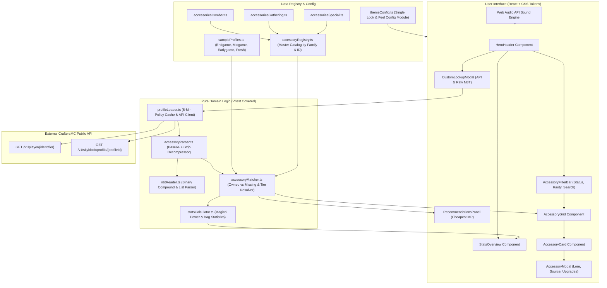

# CraftersMC SkyBlock Accessory Bag & Missing Talismans Tracker

A web application designed for CraftersMC players to audit their SkyBlock accessory bags, identify owned and missing accessories, calculate Magical Power (MP), and discover the cheapest talisman upgrades.

---

## One-Command Run Instructions

### 1. Install Dependencies & Start Dev Server

```bash
npm install && npm run dev
```

Open [http://localhost:5173](http://localhost:5173) in your browser.

### 2. Build & Preview Production Bundle

```bash
npm run build && npm run preview
```

### 3. Run Automated Test Suite

```bash
npm run test
```

### 4. Run End-to-End Verification Script

```bash
npm run verify
```

---

## Architecture Diagram



---

## Policy Compliance Summary

This application complies with the **CraftersMC Public API Usage Policy**:

- **Mandatory Disclaimer:** Displayed across headers and footers stating non-affiliation with CraftersMC, TEON CREATIVE, Minecraft, Mojang, Microsoft, or Xbox.
- **Zero OAuth:** No OAuth login flows (Discord/Xbox) required or used.
- **No Background Tracking:** Lookups are on-demand only; no continuous polling or session tracking.
- **Mandatory Caching:** Client-side caching (5-minute TTL) is enforced to prevent excessive API requests.
- **Single Developer Key:** Key is optionally supplied for personal quota and never broadcasted.
- **Zero Monetization:** 100% free with no gambling, trading, or in-game currency exchanges.

---

## Project Structure

```text
craftersmc-accessory-bag/
├── src/
│   ├── components/        # React UI presentation & interactive modal components
│   │   ├── AccessoryCard.tsx         # Item card with status badge and pricing tag
│   │   ├── AccessoryFilterBar.tsx    # Search, category, rarity, and status filters
│   │   ├── AccessoryIcon.tsx         # Pixel art icon with multi-candidate fallback
│   │   ├── AccessoryModal.tsx        # Detail dialog (lore, recipe tree, auctions)
│   │   ├── CustomLookupModal.tsx     # Player lookup and raw NBT import dialog
│   │   ├── HeroHeader.tsx            # Header with sample profiles and audio toggle
│   │   ├── RecommendationsPanel.tsx  # Next accessory upgrade recommendations
│   │   └── StatsOverview.tsx         # Magical Power and completion stat metrics
│   ├── config/            # Look & feel configuration module
│   │   └── themeConfig.ts            # Rarities, MP mapping, colors, and disclaimers
│   ├── data/              # Accessory catalog, recipes, and pricing snapshots
│   │   ├── accessories*.ts           # 85 obtainable accessories categorized by domain
│   │   ├── accessoryRecipes.ts       # Compact craft recipe definitions
│   │   ├── accessoryRegistry.ts      # Master registry and family indexing
│   │   ├── pricingData.ts            # Live snapshot interfaces and bindings
│   │   ├── pricingSnapshot.json      # Offline fallback Bazaar & Auction data
│   │   └── sampleProfiles.ts         # Preloaded player profiles for zero-config demo
│   ├── logic/             # Pure domain logic (100% Vitest unit test coverage)
│   │   ├── accessoryMatcher.ts       # Owned vs missing resolution & MP attribution
│   │   ├── accessoryParser.ts        # Base64 Gzip decompressor and NBT analyzer
│   │   ├── nbtReader.ts              # Big-endian binary Named Binary Tag parser
│   │   ├── pricingEngine.ts          # Recipe craft cost & auction pricing engine
│   │   ├── profileLoader.ts          # CraftersMC API client with 5-min policy cache
│   │   └── statsCalculator.ts        # Pre-computed family metrics & bag MP totals
│   ├── utils/             # Helper utilities
│   │   └── soundEffects.ts           # Web Audio API procedural sound engine
│   ├── App.tsx            # Main application layout and coordinator
│   ├── main.tsx           # React DOM root entry point
│   └── index.css          # Design token system and glassmorphism styling
├── public/
│   └── icons/accessories/ # 86 authentic CraftersMC Wiki pixel-art sprites
├── api/                   # Serverless CraftersMC API proxy for Vercel deployment
├── scripts/               # Wiki data sync, live pricing scraper, and automation
├── vercel.json            # Vercel SPA routing and serverless proxy rewrites
└── package.json           # Project manifest and scripts
```
